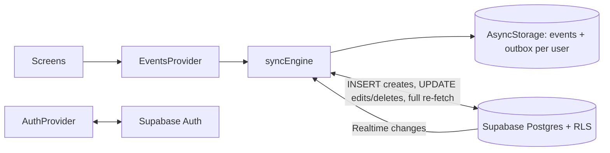

# Architecture

Last updated: 14/10/2026

## 1. Overview

Plan-Me is an Expo (SDK 54) React Native app written in TypeScript, using expo-router for navigation. React Native 0.81, React 19.1, New Architecture and the React Compiler are enabled.

| | Current (v1.0.0, unreleased) | Target (FEAT-002) |
|---|---|---|
| Users | One person, one device | Email/password accounts |
| Storage | AsyncStorage on the device | Supabase Postgres + on-device cache |
| Sharing | None | Families; events are personal or shared |
| Backend | None | Supabase (Auth, Postgres, Realtime, Storage) |

## 2. Current architecture

### 2.1 Code layout

```
app/
  _layout.tsx           Root stack, theme provider
  (tabs)/_layout.tsx    Bottom tabs: Home, Family
  (tabs)/index.tsx      Planner UI and state
lib/
  dates.ts              NZ date keys, week ranges
  parse/                preprocess, recurrence, tags, parseEventInput (pure, Jest-tested)
  events/               LocalEvent types, sorting, stored-data migration (note: repeat column next to series_id in Postgres)
components/, hooks/, constants/   Expo template theming helpers
patches/                patch-package fixes for react-native-calendars
```

### 2.2 Data model (AsyncStorage key `planMeTasks`)

A JSON object keyed by date (`yyyy-mm-dd`, NZ time), each holding an array of events sorted by start time:

```ts
type Event = {
  id: string;            // Date.now() + random suffix
  dateKey: string;       // 'yyyy-mm-dd'
  name: string;          // activity text, defaults to "Busy"
  startTime: string;     // 'HH:mm' or ''
  endTime: string;       // 'HH:mm' or ''
  people?: string[];     // person tags, currently 'AZ' | 'GS'
  occurrenceId?: string; // shared by every occurrence of one recurring event
};
```

`loadData` migrates older shapes on read: it adds missing `id`/`dateKey`, splits the old `time` field into start/end, and pulls `@AZ`/`@GS` out of names into `people`.

### 2.3 Input parsing pipeline (`handleAddTask`)

1. Extract `@AZ` / `@GS` person tags.
2. `parseRecurrence`: `daily|weekly|fortnightly|monthly for N weeks|months`, or `every N days|weeks|months for N …`. Recurrence is **expanded into separate events** that share an `occurrenceId`.
3. `preprocessInput`: expands shorthand ranges (`2-5pm` → `2pm-5pm`, `11-4` → `11am-4pm`).
4. `chrono-node` parses the date and time. If there's no date, the selected calendar day is used. If there's neither a date nor a time, the user sees an error.
5. Anything left after removing the parsed text becomes the event name.

### 2.4 UI

- Week strip (swipe left or right to change week), a month label that opens a `Calendar` modal, and Today / Week / All view modes.
- `SectionList` of events. In "Modify" mode each event shows Edit and Delete.
- Recurring delete offers "this event only" or "this and all future".
- Past events are dimmed. All dates are calculated in `Pacific/Auckland`.

### 2.5 Known structural issues

- Parsing is pure and unit tested (`lib/parse`); UI and AsyncStorage access are still in `index.tsx` until FEAT-002 phase D.
- Person tags and their icons are hard-coded.

## 3. Target architecture (FEAT-002)

Full design: [Accounts and family sharing](../superpowers/specs/2026-10-06-accounts-family-sharing-design.md).

```
app/
  (auth)/sign-in, sign-up, forgot-password (built, Plan 3)
  auth-callback.tsx, reset-password.tsx   Email link targets (outside the sign-in gate)
  (tabs)/…              Planner, reachable only when signed in
  (tabs)/family.tsx     Family tab (built, Plan 5)
  family/create.tsx     Create a family (built, Plan 5)
  family/join.tsx       Join with an invite code (built, Plan 5)
  settings/index.tsx    Settings: profile, photo, account (built, Plan 6)
  settings/password.tsx Change password (built, Plan 6)
  settings/delete-account.tsx  Delete account (built, Plan 6)
lib/
  supabase.ts           Supabase client; session in expo-secure-store (built, Plan 3)
  auth/lastUser.ts      Persist and read the last signed-in user for offline start (built, Plan 4)
  parse/                Tag, recurrence, range, and chrono parsing (pure, unit tested)
  events/uuid.ts        UUID helpers (built, Plan 4)
  events/ids.ts         UUID generator (with the react-native-get-random-values polyfill) (built, Plan 4)
  events/rows.ts        Row type and conversions (built, Plan 4)
  events/failures.ts    Classifies Supabase errors as network / auth / rejected (backoff lives in syncEngine) (built, Plan 4)
  events/outbox.ts      Outbox queue and flush (built, Plan 4)
  events/store.ts       AsyncStorage read/write (built, Plan 4)
  events/pull.ts        Full re-fetch from server (built, Plan 4)
  events/merge.ts       Merge server rows into cache (built, Plan 4)
  events/syncEngine.ts  One user's local-first sync: outbox, pull, Realtime, retries (built, Plan 4)
  events/repeat.ts      Repeat rules and date generation (built, FEAT-004)
  events/editForm.ts    Form-to-event and event-to-form conversion (built, FEAT-004)
  notifications/        Morning summary text, 14-day schedule, setting, expo-notifications wrapper (built, FEAT-005)
  events/legacy.ts      One-time import of pre-account events (built, Plan 4)
  family/types.ts       Family and member types (built, Plan 5)
  family/validation.ts  Tag and name validation rules (built, Plan 5)
  family/api.ts         Family RPCs and member calls (built, Plan 5)
  family/cache.ts       Family data caching per user (built, Plan 5)
  family/tags.ts        Tag helpers (built, Plan 5)
  family/tagMapping.ts  One-time @AZ/@GS tag mapping (built, Plan 5)
  family/messages.ts    Messages for family and profile actions (built, Plan 6)
  profile/avatars.ts    Upload, replace, sign and delete profile photos (built, Plan 6)
  profile/pickAvatar.ts Photo picker, square crop, 256 × 256 JPEG (built, Plan 6)
context/
  AuthProvider.tsx      Session, profile (built, Plan 3)
  EventsProvider.tsx    React access to events; the planner's only data source (built, Plan 4)
  FamilyProvider.tsx    Family, members, tag → member lookup (built, Plan 5)
components/navigation/RootNavigator.tsx   Stack.Protected gate
components/events/SyncBadge.tsx           Offline/pending-change status badge (built, Plan 4)
components/events/LegacyImportPrompt.tsx  One-time prompt to import pre-account events (built, Plan 4)
components/events/ShareToggle.tsx         Personal/Shared toggle for event input (built, Plan 5)
components/events/MemberAvatar.tsx        Member photo, or a coloured circle with their tag (built, Plans 5–6)
components/events/EventForm.tsx           Event edit form (built, FEAT-004)
components/events/form/                   Form inputs: Chip, DateField, TimeField, RepeatPicker, PeoplePicker (built, FEAT-004)
components/events/EditEventScreen.tsx     Full-screen edit form layout (built, FEAT-004)
app/event/[id]/edit.tsx                   Edit route handler (built, FEAT-004)
context/MorningSummaryProvider.tsx        Keeps the scheduled morning summaries in step (built, FEAT-005)
components/settings/MorningSummarySettings.tsx  Morning summary on/off and time (built, FEAT-005)
components/family/FamilyScreen.tsx        Family tab UI (built, Plan 5)
components/family/TagMappingPrompt.tsx    One-time @AZ/@GS mapping prompt (built, Plan 5)
components/profile/ProfileForm.tsx        Name, tag and photo form (Family tab and Settings) (built, Plan 6)
components/settings/SettingsScreen.tsx    Settings screen (built, Plan 6)
supabase/
  migrations/*.sql      Schema, RLS policies, triggers, RPC functions
  tests/*.sql           pgTAP policy tests
```

### 3.1 Data flow



Writes go to the cache first, so the UI updates immediately. They are queued in an outbox and sent when online. The last save to reach the server wins; a full re-fetch replaces the cache with what the server returns, except events with changes still queued on the phone.
